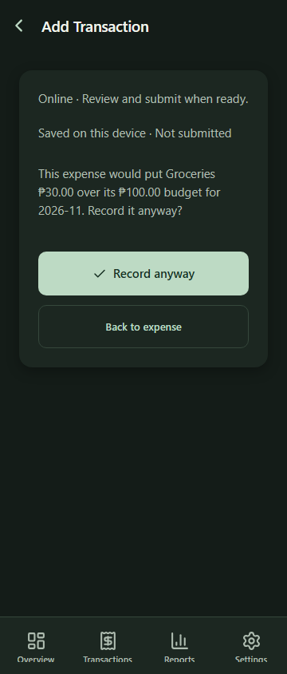
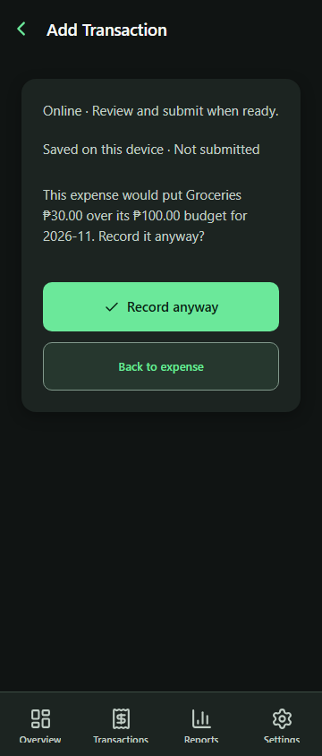

# Charcoal and vivid green dark mode

The user selected option 1 from the visual palette comparison and approved implementation. Preserve the mobile layout and existing financial behavior while improving dark-mode separation and action visibility.

- Shared palette: charcoal background `#101413`, card `#1C2421`, raised surface `#29352F`, vivid green action `#6BE89A` and dark action label `#092316`. Text/muted/placeholder colors are brighter neutral greens. Financial status and category/account colors remain unchanged.
- New shared `inputBackground`, `controlBackground` and `controlBorder` roles distinguish inset fields, raised secondary buttons and clear interactive boundaries from decorative separators. Light roles alias existing white surface and light border colors.
- Apply roles to shared forms plus custom transaction search, month/date controls, receipt buttons, transfer autocomplete and budget edit controls. Existing primary/FAB/update/navigation colors inherit the new palette. Money inputs supply the themed placeholder default.
- Keyboard-visible web button focus uses a 2px accent outline with a 3px offset. Existing disabled behavior, pressed feedback, motion preferences, dimensions and spacing remain.

Verification: 142 targeted tests/13 suites pass, including four contrast checks for normal text/placeholders, primary/selected labels, focused/pressed boundaries, and light-role compatibility. TypeScript, full Expo lint, whitespace and all-platform production exports pass. Export `dist/dark-contrast-verified` contains 96 files and passes required public settings/private-value audit. Synthetic phone-web production checks pass at 390px light and 360px dark with Reduce Motion: measured theme colors, visible keyboard focus, category blur, confirmation-only saves, draft retention, chart rendering, Settings and no horizontal overflow. Native device check found no connected phone/emulator; native appearance and accessibility remain unverified.

The initial review fixture used Expo's hydrated URL to select budget data; corrected the test to scope that fixture explicitly to the review action. No application logic change was needed. All browser backend requests use synthetic fixtures; no real financial writes.

## Synthetic before and after

| Previous dark palette | Charcoal and vivid green |
| --- | --- |
|  |  |

PR update only. No database migration, native dependency, new APK or OTA publication is included.

Subsequent delivery: the user explicitly requested OTA publication. Published the audited export to Android preview runtime1.0.2, source `0138019`, group `f0ab30f0-fa69-4a6c-abd0-f502b844e713`, update `01a19368-bcb1-74f8-b2bc-668cc21c9340` at `2026-10-31T19:21:17.233Z`. Live manifest launch bundle/all29 asset hashes match. Direct launch download returned403 here, so phone delivery remains unverified. Runtime1.0.1 unchanged; no new APK or database deployment.
