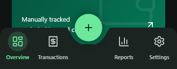
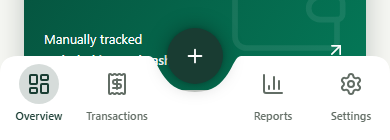

# Voice, navigation and preferences release

This release builds on PR #12's offline drafts, security, entry confirmations and dark contrast. The separate pull request targets that feature branch so reviewers see only the additions below.

## Delivered behavior

- Manual, Scan, Upload and Voice appear in a 2x2 entry grid. Up to 20 compatible spoken purchases become editable rows in one reviewed expense; exact cent arithmetic derives the total. Missing prices block save. Mixed dates, accounts, currencies or directions require separate recordings. Generated notes follow row edits until manually overridden; encrypted draft recovery preserves that choice and exact-save retries.
- Voice admission is authenticated and rate limited on the server. Existing cooldown, per-owner/global quotas, concurrency leases, reset checks and replay protection remain. Temporary audio and transcripts do not become stored financial records. Only the normal reviewed Save writes a transaction.
- Camera, library, avatar and microphone permission handoffs use a bounded owner-scoped app-lock guard. Recovery after Android activity recreation requires explicit Resume and never restores an unlock exemption. Recording itself does not bypass background locking.
- The bottom bar keeps a fixed center + and U cutout, four stationary tab labels/icons, rounded top corners and square bottom corners. A translucent liquid active highlight redirects on rapid taps and settles within 340 ms; Reduce Motion uses fades. The cutout reveals page content. Two soft black shadow layers have zero horizontal/vertical offset around +, without a second Android elevation shadow. The bar shields covered controls from taps; scroll padding accounts for enlarged text.
- Account preferences offer long English, MM/DD/YYYY, DD/MM/YYYY and ISO dates without changing stored financial dates or CSV transport. Notification controls require phone permission and offer permission/settings recovery. Privacy & security has extra top padding. Toasts expire after five seconds.

## Compatibility and deployed services

Android runtime is 1.0.3, versionCode 7, using the existing package and signing identity. The existing 1.0.3 APK includes expo-audio and microphone permission. A 1.0.2 install needs that APK once; compatible updates then use Android preview OTA. No APK rebuild is needed for the centered-shadow adjustment.

Migrations 0038 (voice admission) and 0039 (date preference), plus the backward-compatible voice-entry Edge Function, are already deployed to the configured Supabase project. No new database deployment is required for this publication. Voice version 1 remains supported; version 2 uses explicit protocol and fingerprint separation.

Earlier verification includes hosted synthetic SQL/concurrency checks, two fictional provider clips, exact totals and missing-price handling, authentication/replay rejection and zero financial writes. Disposable owners and temporary audio were removed; anonymized usage receipts remain for global quota accounting.

## Verification limits

Production phone-sized web checks cover dark/light themes, reduced motion, navigation/grid interactions, transparent cutout, centered shadow, tap shielding and item/note draft recovery. They do not establish native microphone/picker/keyboard behavior, safe areas, screen-reader behavior, frame performance or OTA installation on a physical phone. Direct Expo launch-asset download has returned HTTP 403 in this environment; manifest bundle/asset hash verification is reported separately from device delivery.

Current previews:

