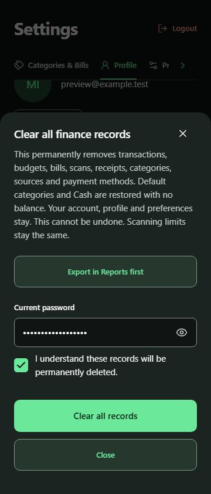
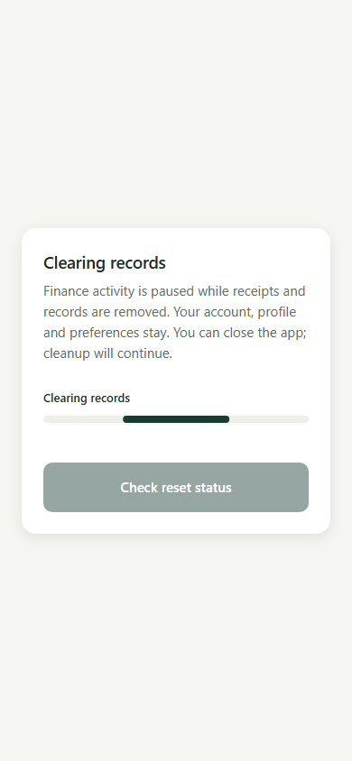

# Form controls and cleanup activity

Implemented the reviewed changes after user approval. A shared PasswordInput adds icon-only eye/eye-off controls to all nine password fields across sign-in, sign-up, recovery, password changes, record reset and account deletion. Values and autocomplete remain with the original forms. Visibility is local, defaults to masked and resets on backgrounding, owner changes, disabling or clearing. Passwords and visibility are never persisted.

Visible checkbox fields replace destructive-action consent chips and the item editor's tax-included switch. Reviewed item counting uses one Include in total checkbox. Unresolved OCR counting decisions retain the required explicit Include/Informational choice; checkbox defaults cannot silently confirm uncertain fees. Existing notification/security/report/bill switches and mutually exclusive financial modes remain.

Reset and deletion status checks are serialized. A request finishes before the next ten-second polling delay starts; manual and foreground checks never cancel or overlap it. Operation changes and unmounting still disqualify old responses. Errors stop timed polling but retain manual/resume recovery. Server completion remains distinct from local device refresh, and missing authentication never establishes successful deletion.

Cleanup progress is indeterminate because the server exposes no work counts. Verification/startup, clearing and device refresh have separate labels; failures pause the bar and retain retry. Reduced Motion uses a static activity marker. Progress semantics explicitly expose an accessible role and text without inventing a percentage.

An owner-scoped account-operation guard hides +, disables underlying tab navigation and hides it from accessibility, dismisses setup/item/bill/keyboard sheets, dismisses the keyboard and invalidates native handoffs. The cleanup overlay has explicit stacking priority. Camera/library/avatar permission launches are blocked during cleanup; late media/voice results cannot prefill an entry. Deferred iOS picker callbacks are cleared on unmount. The busy destructive confirmation remains available while starting its own operation. Late deletion request responses cannot overwrite a different pending job.

Verification: 188 related tests across 28 suites passed, followed by passing final progress/accessibility rechecks. TypeScript, full Expo lint, whitespace checks and production Android/iOS Hermes/static web exports passed. The 98-file export includes expected public configuration and excludes private environment values. Synthetic phone-web at 360px dark and 390px light/Reduce Motion verifies eye toggles, checked semantics, password/consent gating, indeterminate progress, no +, overlay hit shielding and one delayed status request beyond the former ten-second cancellation boundary, then an enabled retry control. No real reset, provider call or financial write occurred.

Runtime verification caught two issues beyond static tests: checkbox checked-state forwarding on web and an animation hook unavailable in the installed react-native-web version. Explicit ARIA semantics and a stable Animated.Value initialized with state resolved them. Actual screenshots were inspected. Physical-native keyboard/caret behavior, screen-reader announcements, safe areas and animation feel remain unverified. No backend migration, OTA/APK publication, Git commit or PR update was performed.

## Optional sender metadata

The shared transaction form now groups sender name, sender phone/account and reference inside Sender & reference (optional), collapsed by default on each fresh form visit. Payment amount remains visible. Collapsing preserves OCR/saved values and edits; payment metadata and cent calculations are unchanged.36 tests across5 form suites, TypeScript, targeted lint and production web export pass. Synthetic 360px dark/390px light Cash edit previews verify default-hidden inputs, explicit expanded state, visible payment amount, preserved leading zeros/edited names across collapse/reopen and zero financial writes. Screenshots inspected. No new OTA or backend change.

## OTA delivery - November 3, 2026 (Asia/Manila)

Android preview runtime1.0.3 published 2026-11-02T16:17:11.250Z: group b2eaa90b-686e-43a9-bb8d-117413844743 / update 01a19d0c-e852-796e-b87b-c863014dcb86. Fresh dist/controls-sender-release-verified31-file Android Hermes export passes public-settings/private-value/runtime/code7 audit and sender/progress/guard feature markers. EAS account/project/preview environment verified. Live manifest bundle/all29 asset hashes match audited export. Direct launch download HTTP403 remains environment limitation; physical-phone delivery unverified. Includes password visibility icons, checkbox controls, serialized clearing/deletion polling, progress and entry guards, default-collapsed renamed sender/reference metadata. Existing188 related tests plus11 final progress rechecks and36 sender/form tests, TypeScript/lint and synthetic light/dark browser verification apply to unchanged tested source. No redundant app tests rerun for publication. EAS gitCommitHash 83999487291d8deb1deebd29b34f321c77fa98a4 is base metadata; these feature changes remain uncommitted and PR13 was not updated. Runtime1.0.2 unchanged; no new APK/backend deployment/Git commit/push/merge.
